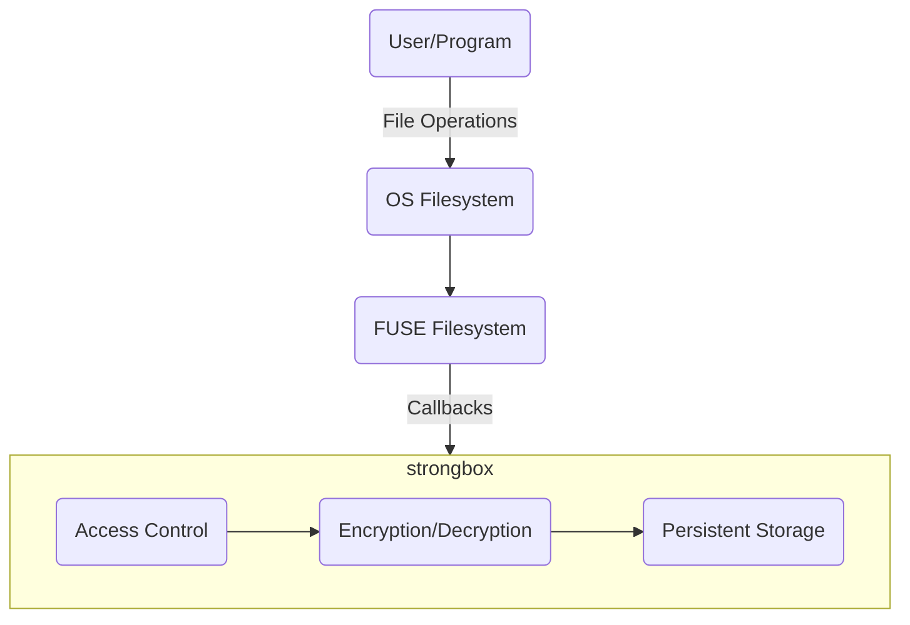

# Strongbox

## Introduction

Strongbox is a secure file system that protects your files through FUSE (Filesystem in Userspace). It monitors file operations through FUSE callbacks, enforces process-based access control, and encrypts all persistent storage to ensure data security.

## Features

- **Process-based Access Control**: Manage file/directory permissions using process whitelists
- **Transparent Encryption**: Automatically encrypts and decrypts files during read/write operations
- **Cross-platform Support**: Works on Linux, macOS, and Windows
- **Secure Storage**: All files are encrypted before being stored on disk
- **Memory-backed Option**: Supports in-memory storage for temporary data

## Architecture



## Usage

### Command Line

```shell
Usage: ./strongbox [options]
  -c string
        Path to configuration file (default "config.yml")
  -ui
        Run with GUI interface (default: true)

Example:
    strongbox -c ./config.yml
```

### Configuration File

The default configuration file is located at `~/.strongbox/config.yml`. If the directory doesn't exist, it will be created automatically.

```yaml
# Mount point for the secure filesystem
mountPoint: /tmp/securebox

backup:
  # Path to encrypted persistent storage
  path: /tmp/securebox_backup.db
  # Enable in-memory storage (true/false)
  memory: false

permission:
  # Default action for unlisted processes (pass/deny)
  defaultAction: deny
  # Process whitelist (full binary paths)
  allowProcess:
    - "/bin/zsh"
    - "/bin/ls"
    - "/bin/rm"
    - "/bin/mkdir"
    - "/usr/local/bin/git"
    - "/Applications/Visual Studio Code.app/Contents/MacOS/Electron"

logger:
  # Log level (debug, info, warn, error)
  level: info
```

### Getting Started

1. **Set Up Configuration**: Edit `~/.strongbox/config.yml` to specify your mount point and allowed processes
2. **Start Strongbox**: Run `./strongbox` (uses default config at `~/.strongbox/config.yml`) or `./strongbox -c ./config.yml` to use a custom config file
3. **Enter Password**: You will be prompted to enter a password for encryption
4. **Access Files**: Only whitelisted processes can access files in the mount point
5. **Automatic Encryption**: All files are encrypted before being stored

## Security

- **AES Encryption**: Uses AES-128 encryption for all stored data
- **Process Verification**: Verifies process identities before granting access
- **Secure Key Management**: Passwords are hashed and never stored in plaintext
- **Isolated Storage**: Encrypted data is stored separately from the mount point

## GUI Interface

Strongbox also provides a GUI interface for easier management. Run with `-ui` flag to use the GUI.

## Build & Installation

### Prerequisites

- Go 1.16+
- FUSE (macOS: macFUSE, Linux: libfuse, Windows: WinFsp)

### Build as Console Application

```shell
go build -o strongbox
```

### Build as GUI Application (macOS)

To create a GUI application without console window on macOS:

1. Install fyne tools:
```shell
go install fyne.io/tools/cmd/fyne@latest
```

2. Create an icon file named `Icon.png` (at least 128x128 pixels)

3. Package the application:
```shell
fyne package -os darwin --app-id com.strongbox.app -name StrongBox
```

4. Run the application:
```shell
open StrongBox.app
```

## License

MIT

