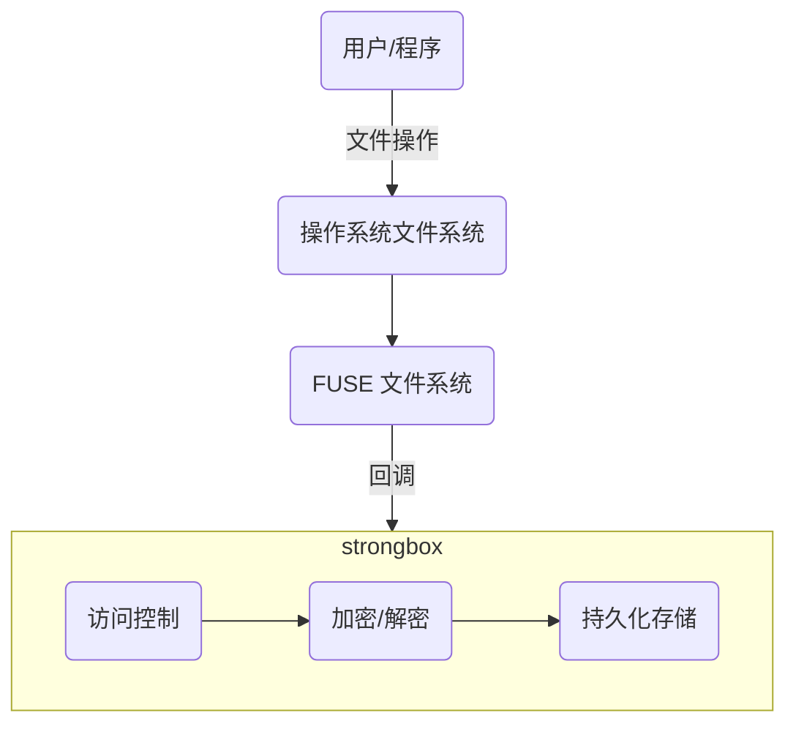

# Strongbox

## 介绍

Strongbox 是一个安全文件系统，通过 FUSE（用户空间文件系统）保护您的文件。它通过 FUSE 回调监控文件操作，实施基于进程的访问控制，并加密所有持久存储以确保数据安全。

## 功能特性

- **基于进程的访问控制**：使用进程白名单管理文件/目录权限
- **透明加密**：在读写操作期间自动加密和解密文件
- **跨平台支持**：适用于 Linux、macOS 和 Windows
- **安全存储**：所有文件在存储到磁盘之前都会被加密
- **内存存储选项**：支持临时数据的内存存储

## 架构



## 使用方法

### 命令行

```shell
用法: ./strongbox [选项]
  -c string
        配置文件路径 (默认 "config.yml")
  -ui
        使用 GUI 界面运行 (默认: true)

示例:
    strongbox -c ./config.yml
```

### 配置文件

默认配置文件位于 `~/.strongbox/config.yml`。如果目录不存在，会自动创建。

```yaml
# 安全文件系统的挂载点
mountPoint: /tmp/securebox

backup:
  # 加密持久化存储路径
  path: /tmp/securebox_backup.db
  # 启用内存存储 (true/false)
  memory: false

permission:
  # 未列出进程的默认操作 (pass/deny)
  defaultAction: deny
  # 进程白名单 (完整二进制路径)
  allowProcess:
    - "/bin/zsh"
    - "/bin/ls"
    - "/bin/rm"
    - "/bin/mkdir"
    - "/usr/local/bin/git"
    - "/Applications/Visual Studio Code.app/Contents/MacOS/Electron"

logger:
  # 日志级别 (debug, info, warn, error)
  level: info
```

### 快速开始

1. **设置配置**：编辑 `~/.strongbox/config.yml` 指定挂载点和允许的进程
2. **启动 Strongbox**：运行 `./strongbox`（使用默认配置 `~/.strongbox/config.yml`）或 `./strongbox -c ./config.yml` 使用自定义配置文件
3. **输入密码**：系统会提示输入加密密码
4. **访问文件**：只有白名单中的进程可以访问挂载点中的文件
5. **自动加密**：所有文件在存储前都会被加密

## 安全性

- **AES 加密**：所有存储数据使用 AES-128 加密
- **进程验证**：在授予访问权限之前验证进程身份
- **安全密钥管理**：密码经过哈希处理，永远不会以明文形式存储
- **隔离存储**：加密数据与挂载点分开存储

## GUI 界面

Strongbox 还提供了 GUI 界面，便于管理。使用 `-ui` 标志运行以使用 GUI。

## 构建与安装

### 先决条件

- Go 1.16+
- FUSE（macOS: macFUSE，Linux: libfuse，Windows: WinFsp）

### 构建控制台应用程序

```shell
go build -o strongbox
```

### 构建 GUI 应用程序（macOS）

要在 macOS 上创建没有控制台窗口的 GUI 应用程序：

1. 安装 fyne 工具：
```shell
go install fyne.io/tools/cmd/fyne@latest
```

2. 创建名为 `Icon.png` 的图标文件（至少 128x128 像素）

3. 打包应用程序：
```shell
fyne package -os darwin --app-id com.strongbox.app -name StrongBox
```

4. 运行应用程序：
```shell
open StrongBox.app
```

## 许可证

MIT